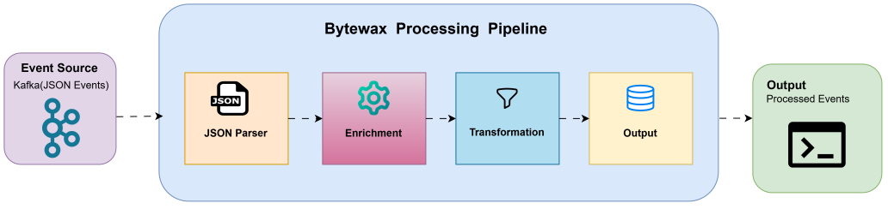
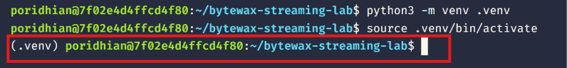
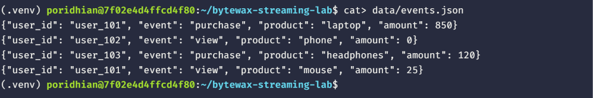
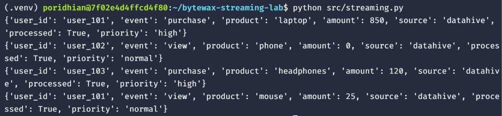
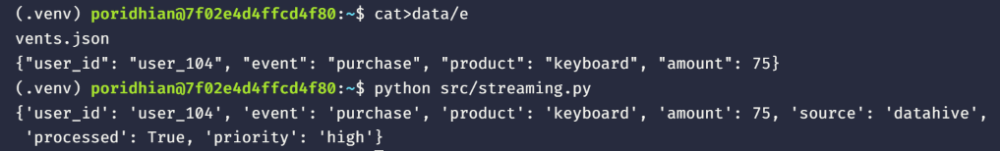
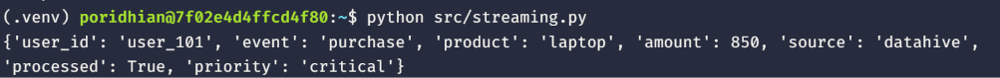
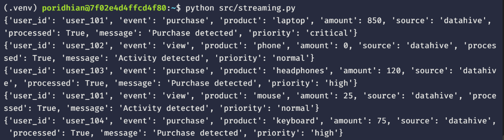

# Python Streaming Basics — Bytewax & Kafka

## Introduction

At DataHive, Bob is working on a system that receives customer activity events continuously. The events contain information such as the user, action, product, and amount, and the team wants to process these events immediately instead of waiting for a batch job. Bob needs a small standalone Python streaming application that can read JSON events, parse them, enrich the records with useful information, and produce the processed results. In this lab, Bytewax will be used to build and test this streaming pipeline, and we will explore how it connects to Apache Kafka for real-time stream processing.




# Chapter 1 — Create the Project

Open the **VS Code Server terminal** and create the project directory:

```bash
mkdir -p bytewax-streaming-lab
cd bytewax-streaming-lab
```


This creates the main workspace for the DataHive streaming application. All source code and sample data will remain inside this directory.

---

# Chapter 2 — Create a Virtual Environment

Create a Python virtual environment (Python 3.10–3.12 recommended for Bytewax prebuilt binary wheels):

```bash
python3 -m venv .venv
```
*(On Windows, you can use `python -m venv .venv`)*

Activate the virtual environment:

- **Linux / macOS**:
  ```bash
  source .venv/bin/activate
  ```
- **Windows (PowerShell)**:
  ```powershell
  .venv\Scripts\Activate.ps1
  ```
- **Windows (CMD)**:
  ```cmd
  .venv\Scripts\activate.bat
  ```



The virtual environment keeps Bytewax and other project dependencies isolated from the system Python installation.

---

# Chapter 3 — Install Bytewax

Using the **VS Code Server Explorer**, create `requirements.txt`:

```text
requirements.txt
```

Add the dependencies:

```text
bytewax>=0.21.0
confluent-kafka>=2.0.0
```

Save the file and run:

```bash
pip install -r requirements.txt
```


Running `pip install` installs Bytewax and Confluent Kafka client libraries into the active virtual environment.

---

# Chapter 4 — Create the Input Events

Using the **VS Code Server Explorer**, create:

```text
data/events.json
```

Add:

```json
{"user_id": "user_101", "event": "purchase", "product": "laptop", "amount": 850}
{"user_id": "user_102", "event": "view", "product": "phone", "amount": 0}
{"user_id": "user_103", "event": "purchase", "product": "headphones", "amount": 120}
{"user_id": "user_101", "event": "view", "product": "mouse", "amount": 25}
```



Each line represents an event generated by the DataHive application, containing user ID, event type, product, and amount. In this lab, the streaming application ingests records from this file, simulating live streaming events arriving from a Kafka topic.

---

# Chapter 5 — Create the Bytewax Application

Using the **VS Code Server Explorer**, create:

```text
src/streaming.py
```

Add:

```python
import json
from pathlib import Path

from bytewax.dataflow import Dataflow
import bytewax.operators as op
from bytewax.connectors.stdio import StdOutSink
import bytewax.testing as testing


def parse_event(event):
    """Parse JSON string into a Python dictionary."""
    if isinstance(event, dict):
        return event
    if isinstance(event, str):
        event = event.lstrip("\ufeff")
    return json.loads(event)


def enrich_event(event):
    """Enrich event record with processing metadata and priority."""
    event["source"] = "datahive"
    event["processed"] = True

    if event["event"] == "purchase":
        event["priority"] = "high"
    else:
        event["priority"] = "normal"

    return event


# Read sample streaming events from data/events.json
events_path = Path("data/events.json")
with open(events_path, "r", encoding="utf-8-sig") as f:
    events = [line.strip() for line in f if line.strip()]

# 1. Initialize Bytewax Dataflow
flow = Dataflow("datahive-stream")

# 2. Ingest the event stream (simulating a Kafka source)
stream = op.input("input", flow, testing.TestingSource(events))

# 3. Transform: Parse JSON
stream = op.map("parse_event", stream, parse_event)

# 4. Transform: Enrich event
stream = op.map("enrich_event", stream, enrich_event)

# 5. Output: Emit to stdout
op.output("output", stream, StdOutSink())

if __name__ == "__main__":
    # Execute the dataflow
    testing.run_main(flow)
```


The application constructs a Bytewax `Dataflow` named `datahive-stream`:
1. It ingests the events from `data/events.json`.
2. Each event is parsed from JSON into a Python dictionary using `op.map("parse_event", ...)`.
3. The enrichment function adds the processing `source`, `processed` status, and `priority`.
4. Processed records flow to `StdOutSink()`.
5. `testing.run_main(flow)` runs the dataflow locally.

---

# Chapter 6 — Run the Streaming Application

From the VS Code Server terminal, run:

```bash
python src/streaming.py
```


The application processes all sample events in real-time and prints the results:



Purchase events receive `high` priority, while view events receive `normal` priority.

---

# Chapter 7 — Verify an Enriched Record

Look at the output for the laptop purchase event:

The original event was:

```json
{
  "user_id": "user_101",
  "event": "purchase",
  "product": "laptop",
  "amount": 850
}
```

The processed record is:

```text
{'user_id': 'user_101', 'event': 'purchase', 'product': 'laptop', 'amount': 850, 'source': 'datahive', 'processed': True, 'priority': 'high'}
```


The original event fields are preserved, while three new enrichment fields (`source`, `processed`, `priority`) are derived and appended.

---

# Chapter 8 — Add a New Event

Bob now receives another event from DataHive. Because our streaming pipeline consumes from `data/events.json`, we can simply append the new event to the input data file—just like producing a new message to a Kafka topic!

Open `data/events.json` and append this line:

```json
{"user_id": "user_104", "event": "purchase", "product": "keyboard", "amount": 75}
```


Notice that we did not need to alter our application code in `src/streaming.py`. In a streaming architecture, application logic remains stable while new incoming events flow through continuously.

---

# Chapter 9 — Process the New Event

Run the application again:

```bash
python src/streaming.py
```


The output now includes the 5th event:



Because its event type is `purchase`, the enrichment stage automatically assigned it `high` priority.

---

# Chapter 10 — Add a Business Rule

Bob now wants DataHive to identify expensive purchases. Any purchase above `$500` should receive `critical` priority.

Update the `enrich_event()` function in `src/streaming.py`:

```python
def enrich_event(event):
    event["source"] = "datahive"
    event["processed"] = True

    if event["event"] == "purchase" and event["amount"] > 500:
        event["priority"] = "critical"
    elif event["event"] == "purchase":
        event["priority"] = "high"
    else:
        event["priority"] = "normal"

    return event


if __name__ == "__main__":
    event = {
        "user_id": "user_101",
        "event": "purchase",
        "product": "laptop",
        "amount": 850
    }

    result = enrich_event(event)
    print(result)
```


Purchases over `$500` are now categorized as `critical`, while smaller purchases remain `high`.

---

# Chapter 11 — Test the Business Rule

Run the application:

```bash
python src/streaming.py
```


Look at the laptop purchase (`amount: 850`):




Its priority is now `critical`. The headphones purchase (`amount: 120`) and keyboard purchase (`amount: 75`) remain `high`.

---

# Chapter 12 — Add an Event Message

Bob wants the processed records to contain a short descriptive message.

Update the `enrich_event()` function in `src/streaming.py`:

```python
def enrich_event(event):
    event["source"] = "datahive"
    event["processed"] = True

    if event["event"] == "purchase":
        event["message"] = "Purchase detected"

        if event["amount"] > 500:
            event["priority"] = "critical"
        else:
            event["priority"] = "high"
    else:
        event["message"] = "Activity detected"
        event["priority"] = "normal"

    return event

    if __name__ == "__main__":
    events = [
        {"user_id": "user_101", "event": "purchase", "product": "laptop", "amount": 850},
        {"user_id": "user_102", "event": "view", "product": "phone", "amount": 0},
        {"user_id": "user_103", "event": "purchase", "product": "headphones", "amount": 120},
        {"user_id": "user_101", "event": "view", "product": "mouse", "amount": 25},
        {"user_id": "user_104", "event": "purchase", "product": "keyboard", "amount": 75},
    ]

    for event in events:
        print(enrich_event(event))
```


Purchase events receive `Purchase detected`, while other activities receive `Activity detected`.

---

# Chapter 13 — Verify the Final Output

Run the application:

```bash
python src/streaming.py
```


Expected output:




All five records have passed through the pipeline, received the appropriate message, and been assigned the correct priority.

---

# Chapter 14 — Connecting Bytewax to Apache Kafka

Now that the stream-processing logic is verified, how do we connect this pipeline to a live **Apache Kafka** cluster in production?

Bytewax includes a native Kafka connector (`bytewax.connectors.kafka`). Because Bytewax decouples stream ingestion from data transformations, our `parse_event()` and `enrich_event()` functions remain **100% identical**! Only the input step changes from `TestingSource` to `KafkaSource`.

In `src/streaming_kafka.py`:

```python
import json
from bytewax.dataflow import Dataflow
import bytewax.operators as op
from bytewax.connectors.kafka import KafkaSource
from bytewax.connectors.stdio import StdOutSink


def parse_kafka_message(msg):
    """Decode and parse raw Kafka message payload."""
    payload = msg.value.decode("utf-8") if isinstance(msg.value, bytes) else str(msg.value)
    return json.loads(payload)


def enrich_event(event):
    event["source"] = "datahive"
    event["processed"] = True

    if event["event"] == "purchase":
        event["message"] = "Purchase detected"
        if event["amount"] > 500:
            event["priority"] = "critical"
        else:
            event["priority"] = "high"
    else:
        event["message"] = "Activity detected"
        event["priority"] = "normal"

    return event


# Initialize Dataflow
flow = Dataflow("datahive-kafka-stream")

# Ingest from Kafka topic 'customer-events'
kafka_source = KafkaSource(
    brokers=["localhost:9092"],
    topics=["customer-events"],
    add_config={"auto.offset.reset": "earliest"},
)
stream = op.input("kafka_in", flow, kafka_source)

# Apply same parsing and enrichment transformations
parsed = op.map("parse_event", stream, parse_kafka_message)
enriched = op.map("enrich_event", parsed, enrich_event)

# Emit processed stream
op.output("stdout_out", enriched, StdOutSink())
```

To run the Kafka streaming pipeline in production across multiple worker processes:

```bash
python -m bytewax.run src.streaming_kafka:flow -w 2
```

This demonstrates how Bytewax allows you to test streaming logic locally and deploy seamlessly to Apache Kafka in distributed production environments.

---

# Troubleshooting

## Bytewax Module Not Found
If you see:
```text
ModuleNotFoundError: No module named 'bytewax'
```
Ensure your virtual environment is active:
- Linux/macOS: `source .venv/bin/activate`
- Windows PowerShell: `.venv\Scripts\Activate.ps1`
Then reinstall requirements:
```bash
pip install -r requirements.txt
```

## Cargo / Rust Compiler Error during Installation
Bytewax provides prebuilt wheels for Python 3.10, 3.11, and 3.12. If you are using Python 3.14+, `pip` may attempt to compile Bytewax from source and report that Cargo is missing. To avoid needing Rust, use a Python 3.10–3.12 virtual environment.

## UTF-8 BOM Decoding Error
If `json.loads` reports `Unexpected UTF-8 BOM`:
In `src/streaming.py`, open the file with `encoding="utf-8-sig"` or add `event = event.lstrip("\ufeff")` in `parse_event()`.

---

# Conclusion

Bob has successfully built a robust Python streaming application for DataHive using Bytewax. The application:
1. Ingests events from a streaming data source.
2. Parses raw JSON events into structured dictionaries.
3. Dynamically enriches records with business priority logic and event messages.
4. Seamlessly scales from local file-based testing to distributed Apache Kafka topics with zero changes to business transformation logic.